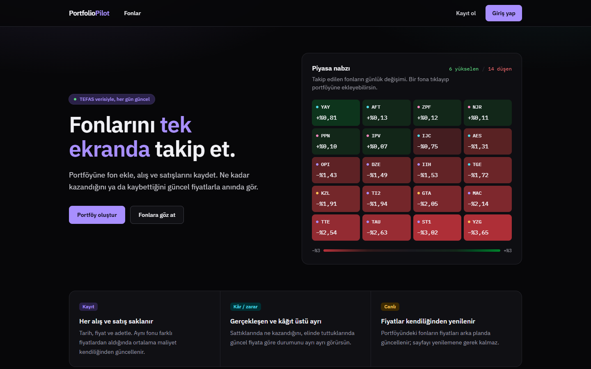
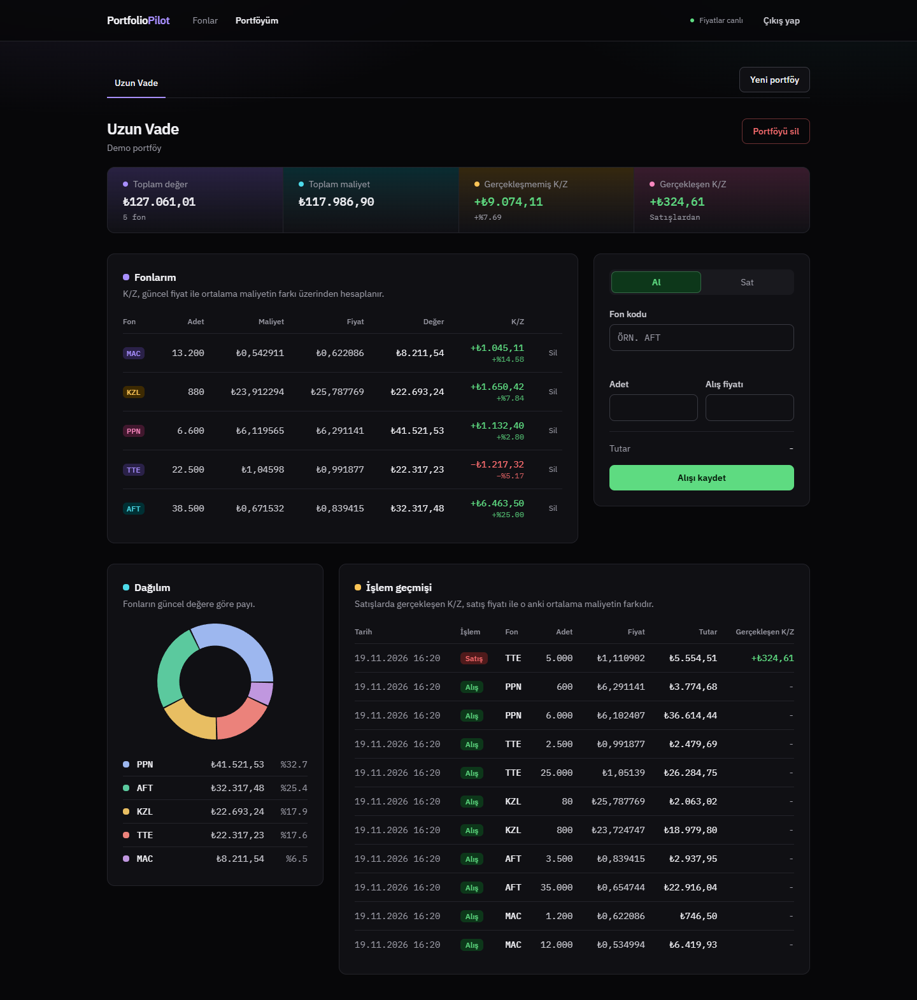
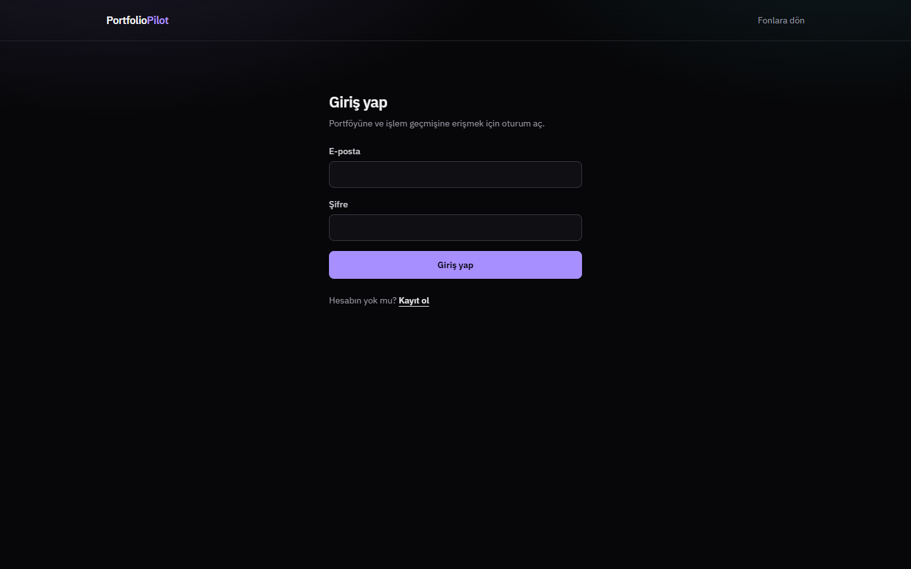

# PortfolioPilot — TEFAS Fund Portfolio Tracker

A full-stack web app for tracking Turkish mutual funds (TEFAS): build portfolios, record every buy and sell, and see realized and unrealized profit/loss against live fund prices. The backend is a **.NET 8 Web API** with **SignalR** for live price pushes. The frontend is **React 19 + Vite + Tailwind CSS**.



## Screenshots

**Dashboard**: summary cards, holdings with P/L, buy/sell panel, allocation chart, and transaction history.



**Sign in**: actions that need an account send you here, then back to where you were.



## Features

- **Public home page:** a live TEFAS fund table and a "market pulse" heatmap of daily changes, grouped by category (equity, foreign & tech, gold & commodities, debt & money market). Viewing it needs no account.
- **Multiple portfolios per user:** create and delete portfolios. Deleting one also removes its funds and history.
- **Buy / sell with a full ledger:** every trade is stored as a transaction. Buys update the weighted average cost. Sells record realized P/L, and the API rejects overselling with `400`.
- **Realized vs. unrealized P/L:** shown separately, both per fund and per portfolio.
- **Live prices:** a background worker refreshes fund prices every 30 seconds, and SignalR pushes the updates only to users who hold that fund.
- **Allocation chart:** a Recharts donut showing each fund's share of the portfolio's current value.
- **Auth:** ASP.NET Core Identity with JWT bearer tokens. Portfolio endpoints and the SignalR hub require authentication.

## Tech Stack

**Frontend** (`frontend/`)
- React 19, Vite, React Router 7
- Tailwind CSS 4
- Recharts, Axios, `@microsoft/signalr`

**Backend** (`src/`)
- .NET 8 Web API, Entity Framework Core 8 (SQL Server)
- ASP.NET Core Identity + JWT bearer authentication
- SignalR, a hosted background service (`FundPriceWorker`)
- FluentValidation, AutoMapper
- HttpClient against the TEFAS API (fund prices) and Yahoo Finance (stocks only)
- Redis distributed cache (`StackExchange.Redis`)
- Swagger (Development only)

**Tests** (`tests/`)
- xUnit tests for the portfolio service and validators

## Architecture

```
src/
├── PortfolioPilot.Domain          # Entities: User, Portfolio, InvestmentFund, FundTransaction
├── PortfolioPilot.Application     # DTOs, service interfaces, PortfolioService/AuthService, validators, mappings
├── PortfolioPilot.Infrastructure  # EF Core DbContext + migrations, TEFAS / finance / Redis services
└── PortfolioPilot.WebAPI          # Controllers, SignalR hub, FundPriceWorker, Program.cs
```

- Layered (Clean Architecture style): Application depends only on Domain and talks to the database through `IApplicationDbContext`.
- DTOs at the API boundary, with FluentValidation on every write payload.
- Services return a `ServiceResult` so the controllers map outcomes to HTTP status codes.
- Async I/O throughout. Dates are returned in UTC, and prices are stored with 6-decimal precision.

## Getting Started

### Prerequisites
- [.NET 8 SDK](https://dotnet.microsoft.com/download/dotnet/8.0)
- [Node.js](https://nodejs.org/) 20+
- SQL Server (LocalDB works; it is the default connection string)
- Redis on `localhost:6379` (optional for local development)

### 1. Clone

```bash
git clone https://github.com/EfkanB/portfolio-pilot.git
cd portfolio-pilot
```

### 2. Backend

```bash
cd src/PortfolioPilot.WebAPI
dotnet restore

# The JWT signing key is NOT stored in appsettings.json. Set it once per machine (min. 32 chars):
dotnet user-secrets set "Jwt:Key" "<long-random-secret>"

dotnet ef database update --project ../PortfolioPilot.Infrastructure
dotnet run
```

The API listens on `http://localhost:5000`, with Swagger at `/swagger`.

### 3. Frontend

```bash
cd frontend
npm install
npm run dev
```

The app runs on `http://localhost:5173`. To point it at a different API, set `VITE_API_URL`.

### 4. Tests

From the repository root:

```bash
dotnet test PortfolioPilot.sln
```

## Deployment

Before deploying, follow the checklist in [DEPLOYMENT.md](DEPLOYMENT.md): JWT key, connection string, CORS, `VITE_API_URL`, and HTTPS.

## API Overview

All `/api/Portfolio` endpoints and the `/portfolioHub` SignalR hub require a JWT (`Authorization: Bearer <token>`; the hub also accepts `?access_token=`). Price updates are pushed only to users who hold the fund.

| Method | Route | Description |
|---|---|---|
| POST | `/api/Auth/register`, `/api/Auth/login` | Account & JWT |
| GET / POST | `/api/Portfolio` | List / create portfolios |
| DELETE | `/api/Portfolio/{id}` | Delete portfolio (funds + history) |
| POST | `/api/Portfolio/{id}/funds` | Buy (weighted average cost) |
| POST | `/api/Portfolio/{id}/funds/sell` | Sell `{ fundCode, quantity, price? }`: records realized P/L, rejects overselling |
| DELETE | `/api/Portfolio/{id}/funds/{fundId}` | Remove a position (data correction, not a sale) |
| GET | `/api/Portfolio/{id}/transactions` | Buy/sell history, newest first |
| GET | `/api/Tefas/funds`, `/api/Tefas/quote/{code}` | Public TEFAS quotes |
